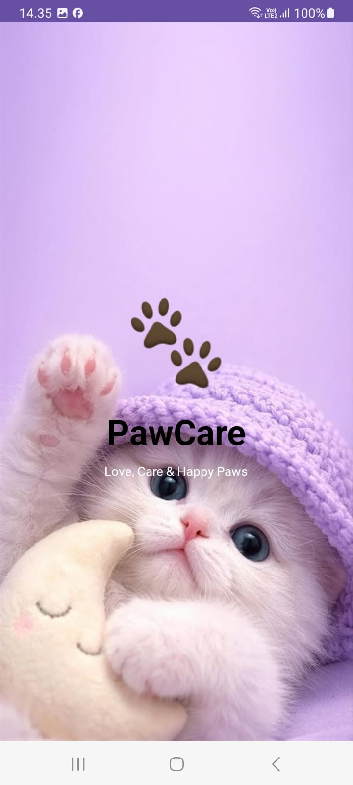
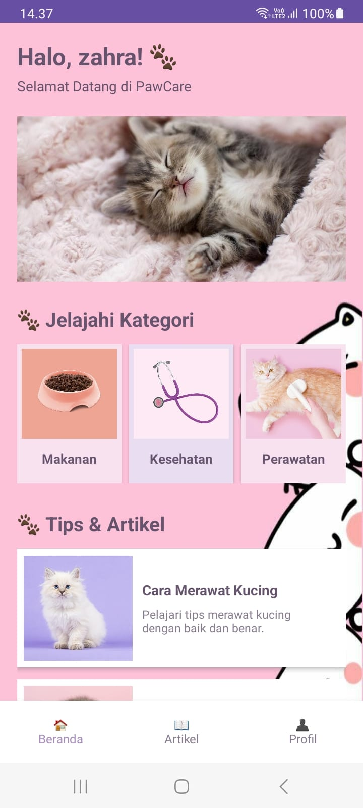
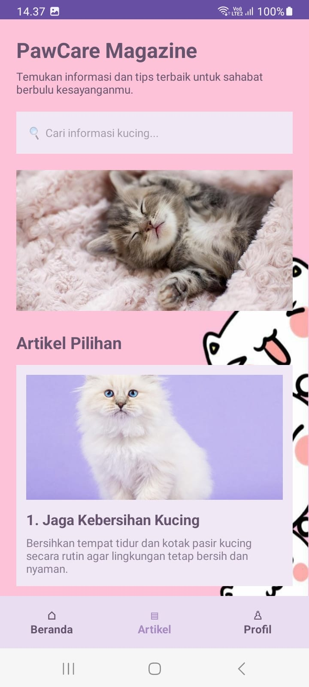

# 🐾 PawCare – Aplikasi Perawatan Kucing

**PawCare** merupakan aplikasi berbasis Android yang dikembangkan untuk membantu pengguna memperoleh informasi seputar perawatan dan kesehatan kucing.

Aplikasi ini dibuat menggunakan Android Studio dengan bahasa pemrograman Kotlin serta XML sebagai bahasa untuk mengatur tampilan antarmuka aplikasi.

PawCare menyediakan informasi dan artikel yang berkaitan dengan kebutuhan perawatan kucing, sehingga pengguna dapat memperoleh pengetahuan dasar dalam merawat hewan peliharaan mereka.

## 2. Fitur dan Layanan Aplikasi

Berikut merupakan fitur-fitur yang tersedia dalam aplikasi PawCare:

- **Splash Screen:** Halaman pembuka yang menampilkan identitas aplikasi PawCare sebelum pengguna masuk ke halaman login.
- **Login:** Fitur untuk masuk ke aplikasi menggunakan email dan kata sandi yang telah ditentukan. Jika email atau kata sandi tidak sesuai, pengguna tidak dapat melanjutkan ke halaman berikutnya.
- **Beranda:** Halaman utama yang menampilkan informasi, gambar, serta beberapa kategori seputar kebutuhan kucing, seperti makanan, kesehatan, dan perawatan.
- **Artikel:** Menyediakan berbagai informasi dan bacaan mengenai perawatan kucing. Dilengkapi dengan fitur pencarian untuk membantu pengguna menemukan artikel.

## 3. Komponen dan Teknologi yang Digunakan

Teknologi dan komponen yang digunakan dalam pengembangan aplikasi PawCare:

- **Android Studio:** IDE untuk mengembangkan aplikasi Android.
- **Kotlin:** Bahasa pemrograman utama aplikasi.
- **XML:** Digunakan untuk membuat dan mengatur tampilan antarmuka aplikasi.
- **Android SDK:** Perangkat pengembangan untuk membangun dan menjalankan aplikasi Android.
- **SharedPreferences:** Digunakan untuk menyimpan beberapa data sederhana pada aplikasi.
- **Intent:** Digunakan untuk perpindahan antarhalaman aplikasi.

## 4. Cara Menjalankan Aplikasi Langsung di HP

Berikut langkah-langkah untuk menjalankan aplikasi PawCare pada perangkat Android:

1. Pastikan perangkat menggunakan sistem operasi Android.
2. Siapkan file APK PawCare yang telah dibuat melalui Android Studio.
3. Pindahkan file APK ke perangkat HP.
4. Buka file APK melalui pengelola file.
5. Ikuti petunjuk pemasangan yang muncul pada perangkat.
6. Setelah proses instalasi selesai, buka aplikasi PawCare.
7. Aplikasi siap digunakan.

## 5. Tangkapan Layar Aplikasi

Berikut merupakan dokumentasi tampilan dari aplikasi PawCare.

<table>
  <tr>
    <td align="center">
      
       Splash Screen
    </td>
    <td align="center">
      
       Login
    </td>
  </tr>
  <tr>
    <td align="center">
      
       Login 1
    </td>
    <td align="center">
      
       Beranda
    </td>
  </tr>
  <tr>
    <td align="center">
      
       Artikel
    </td>
  </tr>
</table>
